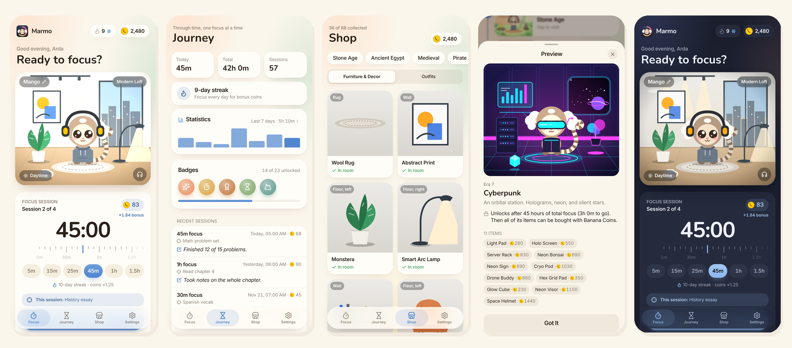
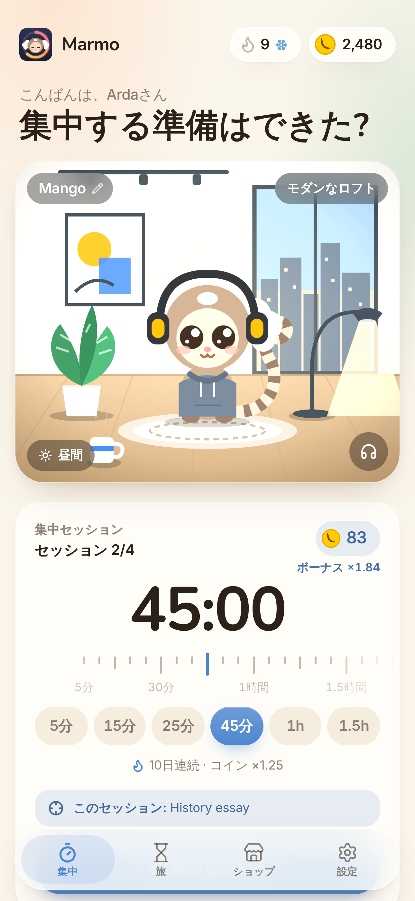
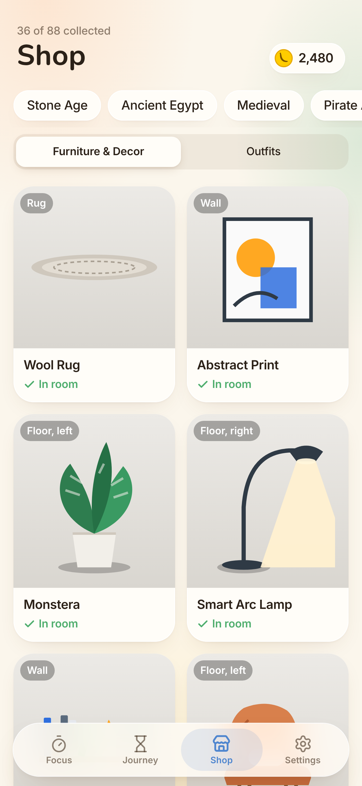
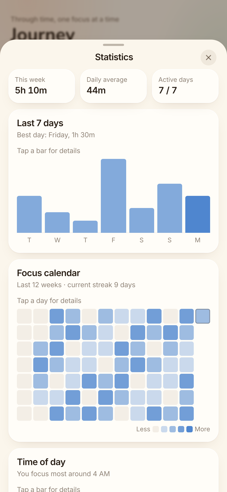

<div align="center">
  

  # Marmo Focus

  <p><b>A cozy focus timer with a time-traveling marmoset companion, ambient sounds, and four languages.</b></p>
  <p><sub>Interface inspired by Apple's Human Interface Guidelines · Built with React and Vite</sub></p>
</div>

---

## ✨ Features

- **Focus sessions with a companion:** Pick 5 minutes to 3 hours. Your marmoset, Mango, falls asleep while you focus and wakes up happy when the session ends.
- **Focus Guard:** Leave the app mid-session and Mango wakes up grumpy; that session pays no bonus. Locking your phone is fine.
- **Banana Coins & eight eras:** Longer sessions earn more coins. Decorate rooms from the Stone Age's Dino Valley to a post-apocalyptic bunker, and dress Mango in 16 outfits.
- **Streaks, notes & statistics:** Daily bonus, streak rewards and streak freezes, a short note after each session, weekly charts and a focus calendar.
- **Ambient sounds:** Rain, forest, fireplace and lo-fi, synthesized live (no audio files).
- **Private by design:** No account needed, no servers, no tracking — everything stays on your device. Export or erase your data anytime.
- **Fair play:** Rewards ignore device clock changes.
- **Four languages:** English, 日本語, Español, Italiano.

---

## 📱 Screenshots



<p align="center">
  
  
  
</p>


---

## 🚀 Getting started

The app lives in [`marmo-focus-src/`](marmo-focus-src). You need [Node.js](https://nodejs.org) 18 or newer.

```bash
cd marmo-focus-src
npm install
npm run dev      # start the local dev server
npm run build    # production build in dist/
npm run ios:sync # build and copy into the iOS (Capacitor) project
```

Developer tools (coin injector, era switcher, timer speed-up) are available in `npm run dev` only. See [`marmo-focus-src/README.md`](marmo-focus-src/README.md) for the full feature notes and project structure.

## 🎨 Assets & credits

- All artwork (the marmoset, eight era scenes, 88 items, outfits and the app icon) is original SVG drawn for this project.
- Ambient sounds are generated in the browser with the Web Audio API.
- Fonts: [Nunito](https://fonts.google.com/specimen/Nunito) (SIL Open Font License); on Apple devices the system font is used.
- Libraries: [React](https://react.dev) (MIT), [lucide-react](https://lucide.dev) icons (ISC), [Vite](https://vite.dev) and [Tailwind CSS](https://tailwindcss.com) (MIT).

## 🔒 Privacy

Marmo Focus collects no data: no accounts on a server, no analytics, no ads, no tracking.
[Privacy Policy](marmo-focus-src/legal/PRIVACY.md) · [Terms of Use](marmo-focus-src/legal/TERMS.md) · Support: ardavelioglu.apps@gmail.com

## 📄 License

© 2026 Arda Velioğlu. All rights reserved.
