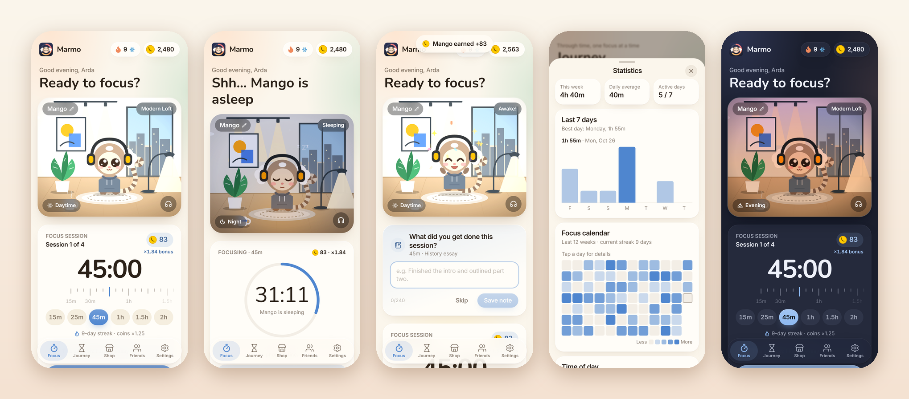
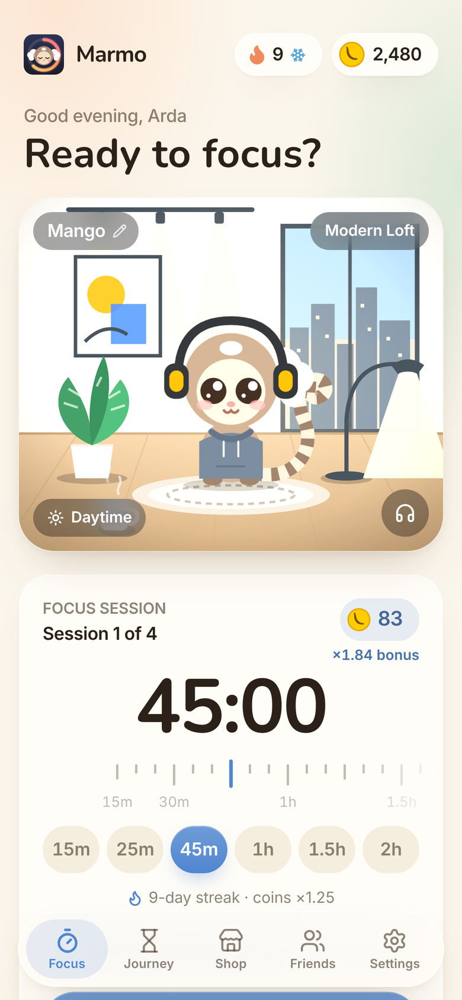
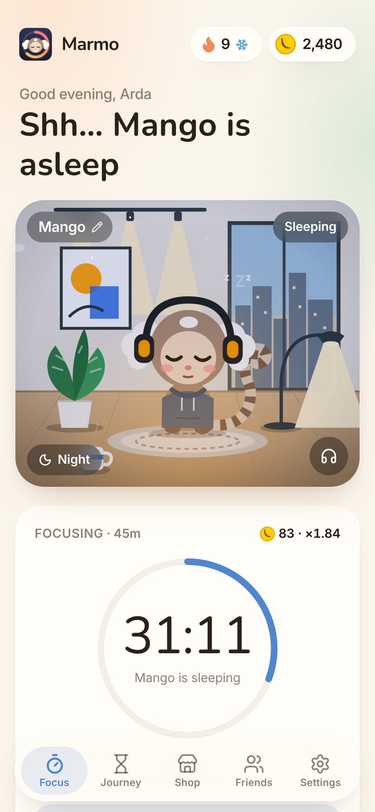
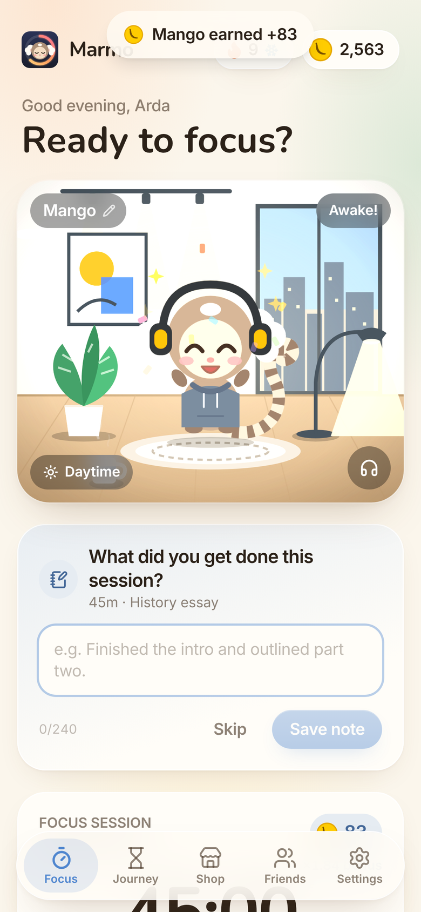
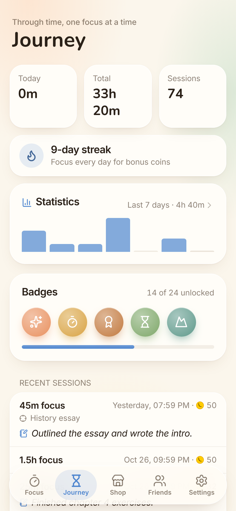
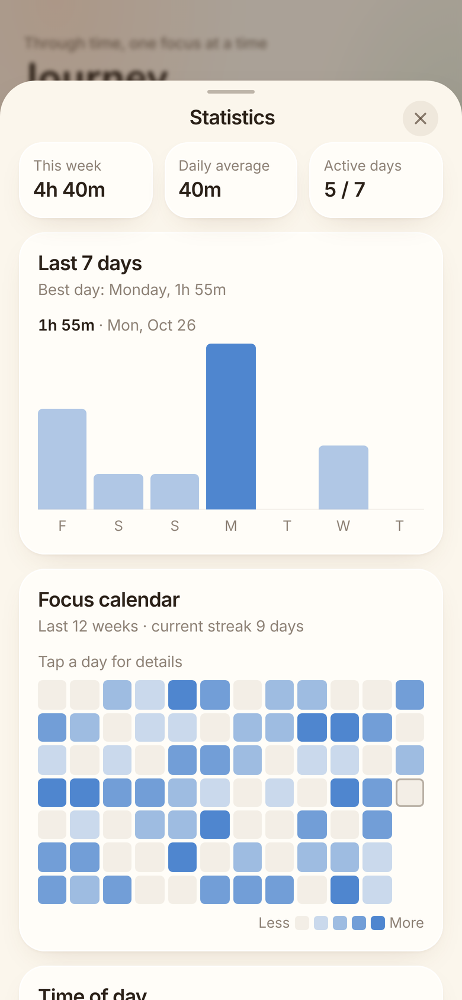
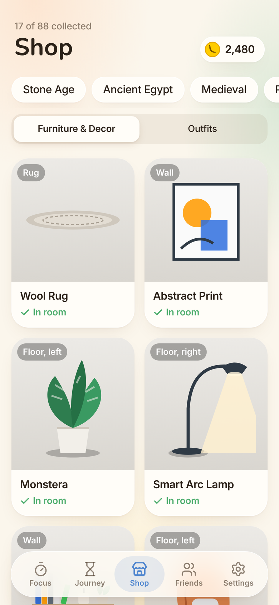
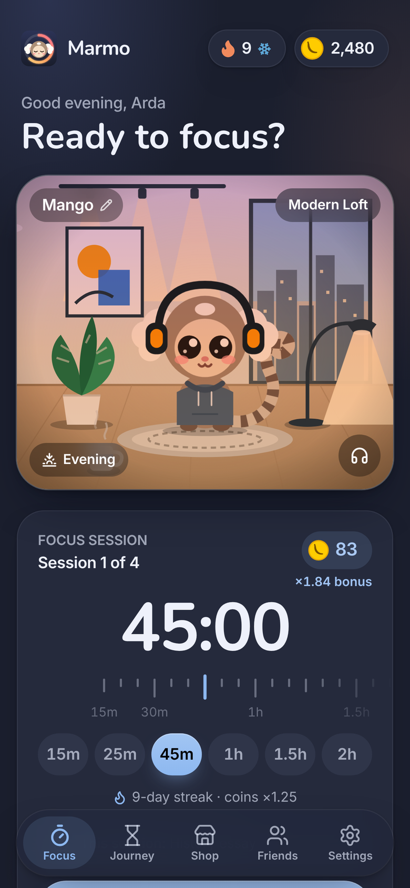
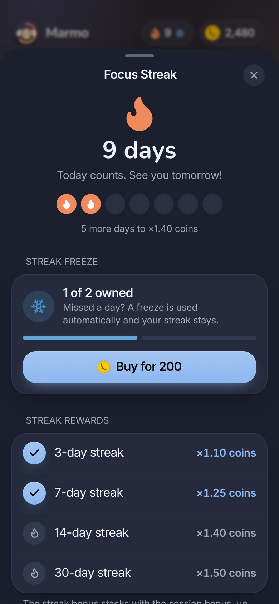
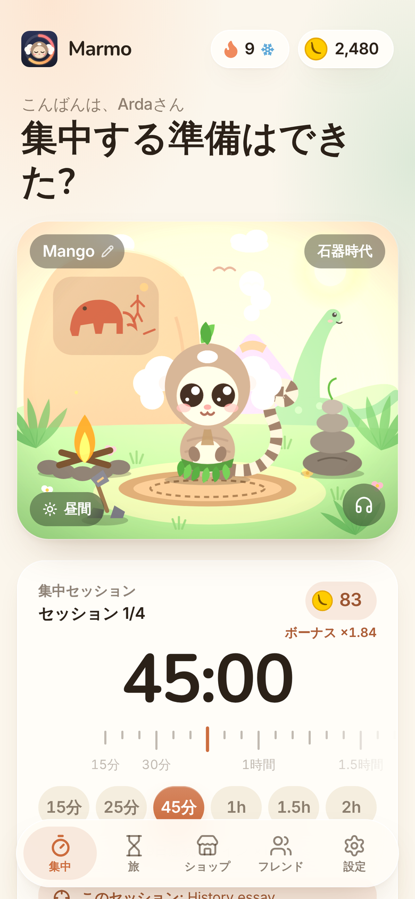

# Marmo Focus — The Time-Traveling Marmoset




<table>
  <tr>
    <td align="center"><br><sub>Pick a session</sub></td>
    <td align="center"><br><sub>Mango sleeps while you focus</sub></td>
    <td align="center"><br><sub>…and wakes up happy</sub></td>
  </tr>
  <tr>
    <td align="center"><br><sub>Journey, badges, notes</sub></td>
    <td align="center"><br><sub>Statistics</sub></td>
    <td align="center"><br><sub>Decorate eight eras</sub></td>
  </tr>
  <tr>
    <td align="center"><br><sub>Dark mode</sub></td>
    <td align="center"><br><sub>Streaks and freezes</sub></td>
    <td align="center"><br><sub>English · 日本語 · Español · Italiano</sub></td>
  </tr>
</table>

A focus timer with an interface inspired by Apple's Human Interface Guidelines. Focus to earn Banana Coins, decorate your marmoset's room, and travel through eight eras, from the Stone Age to the Post-Apocalypse.

## Run

```bash
npm install
npm run dev          # local dev server
npm run build        # production build → dist/
npm run build:single # one self-contained HTML file → dist/index.html
```

Stack: React 18 · Vite 6 · Tailwind CSS 4 (`@tailwindcss/vite`) · lucide-react. All art is hand-built SVG with CSS animation; there are no image assets.

## What changed in 1.1

| Area | Change | Files |
|---|---|---|
| Sessions | One flexible session card replaces the Focus / Short / Long tabs: presets 15m · 25m · 45m · 1h · 1.5h · 2h plus a 5–180 min slider. A break follows each session (one fifth of its length, 5–30 min, or a fixed length). | `components/views/FocusView.jsx`, `lib/economy.js`, `state/store.jsx` |
| Coins | `coins = minutes × 1.012^(minutes − 5)`. The card shows the payout, the bonus multiplier and a curve of it. Giving up pays nothing. | `lib/economy.js` |
| Shop | 88 items (was 40): each slot now has two variants, a new *small prop* slot sits in front of the marmoset, and every era has two outfits. One item per slot stands in the room; you keep everything you buy. | `data/shop.js`, `components/art/items2.jsx`, `components/art/Marmoset.jsx`, `components/Room.jsx` |
| Teasers | Locked eras show their items blurred under drifting fog with a lock, price and time to unlock. Each unlocked shop page ends with a "Coming up" strip for the next era. | `components/views/ShopView.jsx`, `index.css` (`.teaser-*`) |
| Pet name | Name your marmoset in onboarding, from the name chip on the room, or in Settings → Your Marmoset. | `components/PetNameSheet.jsx`, `state/store.jsx` |
| Saves | 1.0 saves upgrade on load: the old focus length becomes the session length and owned, visible decor gets placed. | `state/store.jsx` → `load()` |

## Economy

Each finished session pays `minutes × multiplier`. Sessions run 15 min – 3 h (default 15 min). The multiplier rises smoothly from ×1.0 at 15 minutes and is capped at **×5.0** at 3 hours (streak bonus included):

`multiplier = 1 + 4 · t^1.25`, where `t = (minutes − 15) / 165`

| Session | Multiplier | Coins |
|---|---|---|
| 15m | ×1.00 | 15 |
| 25m | ×1.12 | 28 |
| 45m | ×1.47 | 66 |
| 1h | ×1.79 | 107 |
| 1.5h | ×2.49 | 224 |
| 2h | ×3.27 | 393 |
| 3h | ×5.00 (max) | 900 |

Tune `MAX_MULT` (the cap) and `CURVE` (1 = linear, higher saves more of the bonus for long sessions) in `src/lib/economy.js`. Era unlocks by total focus hours: 0 · 2 · 5 · 10 · 18 · 30 · 45 · 65.

## Look and feel (1.2)

Warm pastel palette with soft gradients and shadows, defined as tokens at the top of `src/index.css`:
- `--sys-*` keep Apple's semantic roles (background, label, fill, separator) with warm values for light and dark.
- `.card`, `.card-tinted`, `.inset` and `.btn-tint` are the shared surfaces; era accent tints are softer (`src/data/eras.js`).
- Rounded display type (SF Pro Rounded on Apple devices, Nunito elsewhere), a floating capsule tab bar, and a greeting header that sets the focus screen lower on the page.

## New in 1.3

| Feature | What it does | Files |
|---|---|---|
| Friends | Friends tab with your friend code, add-by-code, a leaderboard (today · this week · all time, by focus time), and room visits that show a friend's marmoset, outfit, decor and stats. | `components/views/FriendsView.jsx`, `lib/social.js` |
| Invites | Share or copy an invite message. You get 250 Banana Coins per friend who joins with your code; a new player who redeems a code gets 100 (once). | `state/store.jsx` (`invite/redeem`, `referral/joined`), `lib/clipboard.js` |
| Sounds | Rain, Forest, Fireplace and Lo-Fi Beats, synthesized live with Web Audio (no audio files). Mix them, set each volume and a master volume. They keep playing across tabs. | `lib/ambience.js`, `components/AmbienceSheet.jsx` |
| Tasks | A to-do list on the Focus tab. Pin one task (crosshair) and it shows beside the timer and is saved with the session. Tasks never pay coins. | `components/TasksCard.jsx` |
| Badges | 21 achievements with progress bars, a summary on the Journey tab, a full sheet with filters, and a toast when one unlocks. Badges don't pay coins either. | `data/achievements.js`, `components/Achievements.jsx` |
| Atmosphere | The room's light follows the time of day (dawn rays, warm day, dusk glow, night with a lamp) and a daily forecast adds rain or, in winter, snow. Override both in Settings → Room Atmosphere. | `lib/atmosphere.js`, `components/art/Atmosphere.jsx` |

### Connecting a real backend for Friends

This build has no server, so `src/lib/social.js` generates friend profiles from their code. The same code always gives the same marmoset, and their daily and weekly totals change from day to day. Three sample friends (LUNA42, KAITO7, ELIF88) are added so the screen isn't empty; they're labeled and can be removed.

To go live, replace the three functions in `social.js` with API calls; no view needs to change:

- `lookupFriend(code)` → `GET /players/:code`
- `getProfiles(codes)` → `POST /players/batch`
- `reportReferral(code)` → `POST /referrals`, then have the server credit the inviter, which the app applies with the `referral/joined` action.

Developer Mode has **Simulate Friend Joining** to test the invite reward and **Unlock All Badges** to preview every badge.

## Structure

```
src/
  App.jsx                 shell: tabs, sheets, toasts, timer driver
  state/store.jsx         reducer + localStorage persistence + 1.0 migration
  lib/economy.js          presets, slider range, multiplier, coins, break length
  lib/ambience.js         Web Audio soundscapes (rain, forest, fire, lo-fi)
  lib/atmosphere.js       time of day + daily forecast
  lib/social.js           friend service (swap for a real API)
  data/achievements.js    badge definitions and progress
  data/eras.js            8 eras: unlock hours, tints, scene palettes
  data/shop.js            88 items with slots, prices and labels
  hooks/useTimer.js       timestamp-based countdown (accurate in background tabs)
  hooks/useAppearance.js  system / light / dark + per-era tint
  components/
    ui.jsx                HIG primitives: grouped lists, switch, segmented control, sheet, action sheet
    Room.jsx              era scene + placed decor + marmoset
    PetNameSheet.jsx      rename the marmoset
    art/                  Marmoset (16 outfits), era scenes, decor (items.jsx, items2.jsx)
    views/                Focus, Journey, Shop, Settings
    DevPanel.jsx          era switcher, +10,000 coins, +1h focus, timer speed, reset
```

## Developer Mode

Developer tools exist only in development builds (`npm run dev`); release builds leave them out. To include them in a build, run `VITE_DEV_TOOLS=true npm run build`.

Tap the logo 5 times on the Focus tab, or turn on Settings → Advanced → Developer Mode. A wrench button then opens the panel. Set the timer to 600× to finish a 25-minute session in about 2.5 seconds.

## Accounts

"Create a Profile" stores your name and your marmoset's name on the device (localStorage). Real cloud accounts need a backend; `state/store.jsx` is the single place to sync state.

## New in 1.4

| Feature | What it does | Files |
|---|---|---|
| Palette | Dark mode is a lighter, pastel mocha; light mode is an off-white cream. | `src/index.css`, `hooks/useAppearance.js`, `index.html` |
| Session card | Big `25:00` readout, a swipeable minute ruler (5-minute steps; drag or mouse wheel on desktop, arrow keys), pill presets and "Session n of 4" for the day. | `components/views/FocusView.jsx` |
| Daily bonus | First open each day pays 10 coins, +2 per streak day (max 30). | `components/Streak.jsx`, `lib/economy.js` |
| Streak | Finishing a session on consecutive days grows the streak. 3 / 7 / 14 / 30 days give ×1.10 / ×1.25 / ×1.40 / ×1.50 coins, stacked with the session bonus up to ×5. New badges for 14 and 30 days. Flame chip on the Focus header, streak card on Journey. | `components/Streak.jsx`, `state/store.jsx`, `data/achievements.js` |
| Session notes | After a focus session a soft card asks "What did you get done this session?". Notes appear under Journey → Recent sessions; 10 notes earn the *Reflective Mind* badge. | `components/views/FocusView.jsx` (`NoteCard`), `components/views/JourneyView.jsx` |

Developer Mode adds **Add 1 Streak Day** and **Show Daily Bonus Again**.

## New in 1.5

| Change | Files |
|---|---|
| Light mode shows a brighter room (lighter night/dusk wash and vignette, slight brightness lift); dark mode is unchanged. | `src/index.css` (`--room-*`), `art/Atmosphere.jsx`, `art/scenes.jsx` |
| The room starts at **Day** and **Clear**; *Auto* is still available in Settings. Older saves still on auto/auto move to day/clear once. | `state/store.jsx`, `SettingsView.jsx` |
| Focus length starts at 15 min (minimum 15, default 15). The ruler only changes the length on a touch, drag or wheel, and is placed before first paint. | `lib/economy.js`, `FocusView.jsx` (`MinuteRuler`) |
| The marmoset sleeps during a focus session (closed eyes, slow dozing sway, floating Zzz). When a session ends he stretches and yawns, then hops with raised arms, a big smile and confetti. Ending early asks: "Mango wants to rest a little longer, I think. End the session now?" | `art/Marmoset.jsx` (moods `sleep` · `wake` · `happy`), `FocusView.jsx` (`useWakeUp`), `index.css` |

## New in 1.6

| Change | Files |
|---|---|
| **Breaks off by default.** No break suggestion after a session; turn it on in Settings → Breaks. Older saves are switched off once and a leftover break card is cleared. | `state/store.jsx` |
| **Clock guard.** Rewards use trusted time (`lib/clock.js` → `now()`). A clock jump while the app is open is cancelled out; turning the clock back pauses coins, streaks and the daily bonus until real time catches up, with a banner on the Focus tab. Set `TIME_URL` to a server endpoint (`{ now: <ms> }` or any `Date` header) to also cover changes made while the app is closed; the web build uses its own origin automatically. | `lib/clock.js`, `hooks/useClockLock.js` |
| **Focus Guard.** Leaving Marmo for more than 10 s during a session wakes the marmoset (grumpy face) and the session pays plain minutes, no bonus. Only time the phone was awake counts, so locking the screen is fine. Toggle in Settings → Focus. | `hooks/useFocusGuard.js`, `art/Marmoset.jsx` |
| **Notifications.** "Session complete" at the end time and a nudge a moment after you leave mid-session. Uses Capacitor Local Notifications in the app, the Notification API on the web. Toggle in Settings → Focus (asks permission). | `lib/notifications.js`, `App.jsx` |
| **Durable saves.** Each save also goes to Capacitor Preferences (app) or IndexedDB (web, with `navigator.storage.persist()`); if localStorage is wiped, the newer copy is restored on launch. | `lib/storage.js`, `state/store.jsx` |
| **Streak freeze.** 200 coins each, hold up to 2. Missed days are covered automatically on the next open. Buy from the streak sheet; a snowflake shows on the streak chip. | `components/Streak.jsx`, `lib/economy.js` |
| **Statistics.** Journey → Statistics: last 7 days, a 12-week calendar heatmap, and focus by hour of day. | `components/Stats.jsx` |
| **Languages.** English, 日本語, Español, Italiano. Settings → Language (Automatic follows the device). English text is the key; translations live in `src/i18n/strings-ui.js` and `strings-world.js`. Era names no longer carry Turkish subtitles. | `src/i18n/` |

### App Store build (Capacitor)

The native features above activate automatically when these plugins are installed in the Capacitor project:

```bash
npm i @capacitor/core @capacitor/ios @capacitor/local-notifications @capacitor/preferences
npx cap sync ios
```

### Adding or changing text

Wrap UI text in `t('English text', { vars })` (or `tp(n, one, other)` for plurals), then add a row `[en, ja, es, it]` to `src/i18n/strings-ui.js`. Placeholders like `{pet}` must appear in every column.

## New in 1.7

| Change | Files |
|---|---|
| **A cuter marmoset.** Baby proportions (bigger head, smaller body), a light honey face, big shiny eyes, fluffy ear tufts, pink nose and cheeks, and a curled tail. Every mood (idle, asleep, waking, happy, grumpy) is redrawn. | `components/art/Marmoset.jsx` |
| **All 16 outfits refitted.** Outfits scale with the head and body; the eye patch, monocle, glasses and cyber visor were moved onto the new eyes, and the space helmet now centers on the head. | `components/art/Marmoset.jsx` (`FIT`, outfit art) |
| **Stone Age is now Dino Valley.** The cave is replaced by a sunny valley with a friendly long-neck dinosaur, a smoking volcano and a warm boulder for wall items. At night the sun becomes a moon with stars. | `components/art/scenes.jsx`, `data/eras.js` |
| **Midnight-blue dark theme.** Dark mode uses cool navy surfaces (`#1b1f2e` / `#252a3c` / `#2f3549`) instead of mocha. | `src/index.css`, `hooks/useAppearance.js` |
| **Starts in light mode.** New installs open in the light theme even when the phone is in dark mode; Settings → Appearance still offers Automatic and Dark. | `state/store.jsx`, `index.html` |
| **New app icon.** A sleeping Marmo inside a glowing focus-timer ring. Used in the app header, the browser tab, "Add to Home Screen" and the App Store. | `public/icon.svg` (source), `public/*.png`, `public/manifest.webmanifest`, `assets/app-store/AppIcon-1024.png`, `FocusView.jsx` (`Logo`) |

### App icon files

| File | Use |
|---|---|
| `public/icon.svg` | Source artwork (rounded square); browser tab icon |
| `public/favicon-32.png` | Browser tab fallback |
| `public/apple-touch-icon.png` (180×180) | iOS "Add to Home Screen" |
| `public/icon-192.png`, `public/icon-512.png` | Web app manifest (Android, desktop install) |
| `assets/app-store/AppIcon-1024.png` | App Store / Xcode asset catalog: square and opaque, iOS rounds the corners itself |
